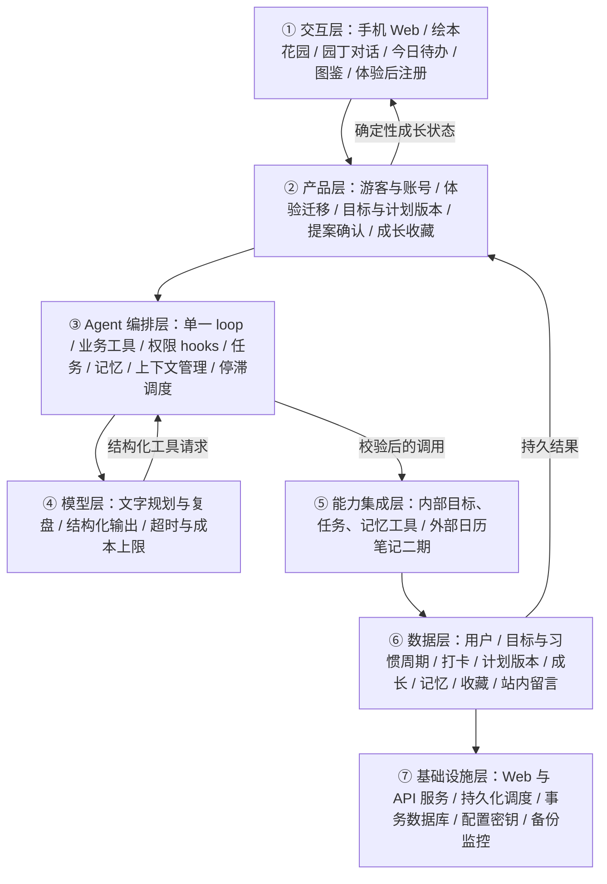

# Bloomate · V3 产品与 Agent 架构方案

日期：2026-10-30。状态：可评审草案。工作区：`out/Bloomate/`。依据：[PRD](PRD.md)、[原始需求](原始需求.md)和用户同日对双线、主动站内关心、阶段成长、习惯收藏的回答及周期打卡提议。

执行方式：当前 AI 按 BLUEPRINT.md 分析，未运行模型管线。已有 API Key 连接返回 401；没有使用 mock 结论，没有独立模型审稿。实际运行了 `blueprint init`、`blueprint revise --no-plan` 和纯规则函数 `select_components`，详细输入输出见 [选型依据.json](选型依据.json)。本文件不代表已有产品代码或线上服务。

## 1. 已确认方向与待确认清单

已确认：产品名为 Bloomate（2026-10-30 用户确认）；以花园表现个人目标进展；手机浏览器 Web 版；AI 计划变更先预览、用户确认后生效；任务和目标由用户确认完成；V2 同时支持明确目标与长期习惯；园丁停滞时主动站内留言；小任务轻反馈、阶段成果明显成长；习惯同株长期生长并留下阶段收藏；简单 2D、固定花位、少量花种、休眠、收藏；日历笔记和商业化后续再做。

V3 用户于 2026-10-30 确认温暖治愈的绘本风，以及先体验对话和种下第一株植物，再注册保存。注册前需清楚提示尚未同步保存；游客与迁移契约为落实该方向的建议设计。

| 待确认项 | 建议草案 | 影响 |
|---|---|---|
| 首批试用人群 | 双线均已确认；具体招募群体与比例待定 | 分线验证 |
| 主动关心剩余参数 | 连续错过 2 次行动后站内留言一次、未回应不重复、用户可关闭已确认；后台检查周期与勿扰默认值待定 | s12、站内信箱与频控 |
| 成长与周期剩余细则 | 最近 3 天补签与阶段标准确认方式已确定；非每日频率、成长份额分配待定 | 两类状态与奖励契约 |
| 花位、花种、装饰数量 | 固定种植位与收藏展示位；数量未定 | 美术和界面范围 |
| 认证、地区、模型预算、数据保留 | 先体验后注册已确认；具体认证方式、游客保留时长与额度仍待工程配置，所有主体相互隔离 | 发布条件与真实模型联调 |
| 试用成功门槛 | 观察连续推进、恢复后推进和目标完成；没有现成留存基线 | 是否继续扩大投入 |

当前交付止于 PRD 与方案。后续生成骨架时按这些决策增量完善；本轮无需为接口无效重复等待，可先评审文档。

## 2. 需求与领域建模

明确目标线：澄清 → 计划确认 → 任务轻反馈 → 阶段明显成长 → 用户确认目标完成 → 整株收藏。

长期习惯线：定义行为 → 确认阶段时间范围、频率与里程碑 → 每日或计划日打卡 → 阶段开花与收藏 → 同株进入下一阶段。到期只触发复盘，不能替代用户确认成果。两线均可暂停恢复；后台发现停滞后先留言关心，计划变更仍需确认。

| Harness 要素 | 本产品内容 |
|---|---|
| 工具 | 读取目标上下文、创建计划提案、确认提案、记录任务完成、切换目标状态、读取或管理授权记忆、查看花园和成果 |
| 知识 | 用户确认的完成标准、可用时间、任务依赖、花园成长规则、产品权限规则；首版无需外部专业知识库 |
| 观察 | 正式计划版本、任务完成/撤销记录、用户困难反馈、事务结果、记忆授权状态；模型回复不作为状态已变更的证据 |
| 行动 | 对话与结构化提案卡片；业务 API 原子更新目标、任务、成长事件；UI 播放已提交成长动画 |
| 权限 | 按用户隔离；AI 可读授权上下文并提案；写正式安排需要匹配的用户确认；用户点击完成即授权单次完成动作 |

## 3. 组件选型

选型特征由当前 AI 基于需求标注，再由项目固定规则计算。这里的“必选”表示本草案架构需要相应机制，不意味着复制完整教学示例。

| 组件 | 决策 | 理由与实现边界 |
|---|---|---|
| s01 Agent Loop | 必选 | 处理对话、工具调用和结果返回；设轮数、时长与用量上限 |
| s02 工具系统 | 必选 | 使用明确 schema 的业务工具，不开放任意 Shell 或数据库写权限 |
| s03 权限系统 | 必选 | 用户确认绑定具体提案与版本；服务器校验用户所有权 |
| s04 钩子系统 | 必选 | 执行前校验权限和版本，执行后记录结果与最小化指标 |
| s05 任务规划 | 必选 | 跟踪澄清、生成提案、等待确认等 Agent 步骤；真实用户待办由 s10 管理 |
| s06 子 Agent | 放弃 | 首版没有并行资料探索任务 |
| s07 技能加载 | 放弃 | 规则规模小，无大型领域知识库 |
| s08 上下文压缩 | 必选 | 工程推断：长期陪伴会积累对话；保留结构化事实，裁剪旧输出，摘要有版本 |
| s09 记忆系统 | 必选 | 授权偏好、冲突处理、召回和删除；与目标业务记录分开 |
| s10 任务系统 | 必选 | 目标、阶段、待办跨日持久化；支持暂停恢复和版本校验 |
| s11 后台任务 | 放弃 | 未提出分钟级作业，普通模型等待用有界异步请求处理 |
| s12 定时调度 | 必选 | V2 后台按本地计划检测停滞、阶段到期并生成站内留言；授权、幂等、频控和最新状态校验 |
| s13 Agent 团队 | 放弃 | 一个园丁角色足够；不需要多 Agent 和隔离代码工作区 |
| s14 MCP 插件 | 二期 | 日历笔记留后续；接入时按实际服务选择原生 API 或 MCP |
| s15 集成 Harness | 必选 | 7 个可选机制协同，归一上下文、权限、工具和状态，不复制整套示例 |
| s16 工作流运行时 | 放弃 | 对话有动态判断；奖励事务由业务代码负责，无需通用工作流引擎 |
| s17 目标闭环 | 放弃 | 用户确认真实任务与目标完成；不需要独立模型自动判断结束 |

参考：仓库 `s03_permission/README.md`、`s09_memory/README.md`、`s10_task_system/README.md`、`s15_integrated_harness/README.md`。参考实现面向教学，不能直接当作多用户生产服务。

## 4. 七层架构



贯穿数据流示例：用户说“这周没时间” → 产品层读取本人目标版本 → 编排层取本周安排和授权偏好 → 模型提出调整 → 内部工具保存提案 → 数据层返回提案 ID → 页面显示差异。用户确认后再次校验版本与权限，事务更新正式计划，返回新的今日待办；不会因为生成一份新计划就发放成长。

横切安全：前端会话、服务端对象所有权、工具确认、数据隔离和密钥管理共同执行，提示词不能替代权限代码。

横切观测：对话请求、模型调用、提案确认和业务事务使用可关联标识；对外分析只发送必要事件，不默认发送对话正文。

## 5. 工具与服务清单

`owner_id` 从服务端验证后的主体会话取得：游客为隔离的临时主体，注册用户为账户主体；不让模型通过参数指定另一个用户。所有写入都带操作 ID 和必要的基准版本。以下是契约草案，工程规格阶段再确定最终接口。

| 名称 | 输入 | 输出 | 副作用 | 权限 | 归属层 |
|---|---|---|---|---|---|
| get_goal_context | 本人 goal_id、时间范围 | 确认事实、任务、计划版本、相关记忆引用 | 无 | allow，校验本人资源 | ⑤ / ⑥ |
| propose_plan | 目标或草案 ID、基准版本、任务变更与理由 | 提案 ID、前后差异、时间负荷、待确认项 | 保存草案，不改正式计划 | allow，限制本人草案 | ③ / ⑤ |
| commit_plan | proposal_id、基准版本、用户确认凭证、操作 ID | 新计划版本和变更清单 | 原子写计划与任务，首次创建绑定种子 | ask，确认由界面签发，模型不可自造 | ② / ⑤ |
| set_task_completion | task_id、完成或撤销、成果摘要、版本、操作 ID | 任务状态与成长事件 | 原子更新完成、成长、解锁资格 | 用户直接点击或明确指令；工具不凭模型推测执行 | ② / ⑤ |
| set_goal_state | goal_id、暂停/恢复/完成/归档、剩余任务处理、操作 ID | 目标、植物与收藏状态 | 状态变更，完成时写收藏快照 | 用户明确指令；完成前展示成果与未完待办 | ② / ⑤ |
| manage_memory | 本人条目、范围、来源、有效期、写入/修改/删除 | 生效条目或删除结果 | 修改授权记忆及衍生召回数据 | 授权范围内写入；新增范围先询问 | ③ / ⑤ / ⑥ |
| get_review | goal_id、周期 | 完成记录、暂停与调整事实、统计口径 | 无 | allow，本人资源 | ⑤ / ⑥ |
| get_garden | 展示布局、目标筛选 | 花位、植物阶段、收藏与解锁 | 无 | allow，本人资源 | ② / ⑤ |
| propose_habit_period | habit_id、阶段日期、频率、单次标准、里程碑、基准版本 | 阶段提案及日期预览 | 只存草案；经 commit_plan 用户确认后写正式周期 | allow 草案；提交 ask | ② / ⑤ |
| set_habit_checkin | occurrence_id、完成/撤销、实际日期、操作 ID | 打卡与轻反馈状态 | 更新唯一实例和阶段累计 | 用户明确操作，按本人时区校验 | ② / ⑤ |
| confirm_habit_milestone | milestone_id、用户确认、操作 ID | 开花与阶段收藏 | 同一里程碑仅一份收藏，不终止习惯 | ask，用户确认 | ② / ⑤ |
| deliver_care_message | 受限后台身份、care_episode_id、证据版本、草稿 | 站内留言或取消原因 | 写本人站内信箱，不改任务 | 后台只读业务状态加受限留言写权限；先检查用户关心设置和频控 | ③ / ⑤ |

V3 的 `claim_guest_experience` 是由注册/登录界面调用的业务接口，不开放为模型工具。输入为受验证的游客会话、目标账户会话、用户保存确认和操作 ID；输出迁移状态及资源映射。只有同时验证源与目标并取得用户确认，才能迁移；不得凭模型给出的 owner_id 认领空间。

成长和奖励的内部计算不是模型工具。AI 只能引用计算结果，不能调用“加经验”“强制开花”或直接改余额。确认提交失败时返回明确失败或冲突，不以自然语言“已安排”冒充成功。

## 6. 关键数据与一致性

| 实体 | 核心字段与约束 |
|---|---|
| Goal | owner、title、用户完成标准、期限、时区、状态、版本；标题是事实，模型建议另存 |
| PlanVersion / Proposal | goal_id、base_version、阶段任务差异、状态、确认时间与确认人；失效提案不可提交 |
| Task | 稳定 ID、阶段、完成条件、预计时长、日期、依赖、状态、成长份额、版本 |
| CompletionEvent / GrowthEvent | 源操作 ID、任务/目标 ID、完成或撤销、份额变动；唯一约束防重复入账 |
| Plant / Collection | 一明确目标或习惯一植物、花种、成长状态、休眠标记、完成或阶段快照、展示位置；目标收藏可移出种植位，习惯阶段收藏保留原株 |
| Unlock | 来源成果 ID 与奖励 ID；一次资格记录，可审计撤销，无重复发放 |
| Memory | 内容、来源、用户授权范围、有效期、确认状态、更新时间、删除状态；不存推断成事实 |
| Habit / HabitPeriod | 长期行为与单次标准；阶段起止、时区、频率、里程碑、版本；默认一个活动周期 |
| HabitOccurrence | 稳定实例 ID、计划执行日、完成状态、实际行动日、录入时间、补签标记；防同日重复计奖 |
| HabitMilestone / Collection | 习惯、阶段、里程碑唯一键，用户确认和成果快照；同株可有多个阶段收藏 |
| CareEpisode / InboxMessage | 触发依据版本、用户设置、冷却、投递/阅读/回应状态、有效期、去重键；发布前再次核验 |
| GuestSession / ExperienceClaim | 不可由客户端伪造的临时主体、有效期、迁移状态、目标账户、操作唯一键；保留源到目标映射，提交后撤销旧访问 |

一次任务完成在一个事务内更新任务、完成事件、成长事件和奖励资格；事务提交后 UI 才展示成长。请求超时先按操作 ID 查结果。动画事件可以重播展示，但业务奖励不会再次发放。

任务拆分继承剩余份额；计划扩展只重分未赚取份额，明确显示完成标准变更。暂停不触发负成长。误点撤销回退该事件及依赖资格；撤销目标完成使对应收藏回到未完成状态，保留历史。

用户确认目标完成时保存成果摘要和当时的完成标准，不用后来改过的标题覆盖历史；重要纠错保留变更记录。删除请求要覆盖正文、摘要、检索索引与可访问缓存，备份的处理时限作为上线前待定策略说明。

### V2 周期打卡与主动调度

按已确认周期规则生成习惯实例，标识稳定并受唯一约束保护；频率与时区修改仅作用于确认后的未来实例。暂停不产生应完成任务，到期进入复盘。打卡只带来轻反馈；用户确认里程碑后按确定性规则开花并保存阶段快照，下一周期继续同株。

2026-10-30 用户确认三项默认规则：

- 补签最近 3 天，显式标记；只记录用户声明已执行但漏记的行动。实现口径为实例计划时区的今天之前 3 个自然日，仅允许已有有效实例，当天正常打卡；保留实际行动日与录入时间。非计划日、暂停日和未来日期不产生补签完成，重复写入受唯一约束保护。
- 阶段标准由 AI 创建时提议、用户修改或确认后落入版本化计划。例如 30 天完成 24 天，不强制全勤，也不把 80% 硬编码为所有习惯的门槛。未确认标准不触发开花；标准变更继续走提案确认。
- 同一目标或习惯连续错过 2 次计划行动后留言一次。按已过执行窗口的实例计数；暂停、取消、非计划日和未安排时间的任务不计错过。无回应时保持已留言状态，不能靠计时重发；查看不等于回应，用户可关闭。恢复行动后才重新统计新的连续错过。

后台定时扫描有效安排与周期状态 → 按规则筛选停滞候选 → 读取最小必要上下文生成关心 → 投递前校验最新完成状态、暂停、用户授权与频控 → 幂等写入站内信箱 → 用户下次打开查看与回应。用户离线不影响候选生成，但首版不触发站外消息。

调度使用服务端时钟和用户时区，持久化最后检查点和停滞事件状态；重启重放须去重，过期关心不补发。投递前校验补签或新完成是否已消除连续错过条件。关心只引用可观察的记录缺口，不断言现实没有执行；用户回复已做则走完成确认。后台不能调用正式计划提交、目标完成或扩展记忆授权。调度检查周期和成本预算可配置，具体数值待验证；频控以已确认的一事件一留言和未回应不重复为准。

## 7. 上下文与记忆策略

优先级：本次明确指令及当前授权 → 当前已确认计划与用户编辑 → 有效的确认偏好 → 相关历史摘要 → AI 建议。信息冲突时不静默覆盖。

每轮只取当前目标、相关时间窗口待办、必要偏好及少量近期对话。游客只使用本次体验上下文，不默认开启跨会话偏好记忆；注册保存后也不自动扩大记忆授权。旧工具结果优先裁剪；长对话按目标摘要，摘要带来源与版本，不取代数据库事实。不得在压缩时丢失未确认状态、用户拒绝和权限边界。

业务记录与长期偏好分开管理。用户创建目标即需要保存该目标才能提供服务，但不等于授权从所有聊天中提炼个人画像。记忆设置明确可记范围，可关闭偏好提取而继续使用目标功能。“这周没时间”优先作为本周约束，除非用户明确要求长期记住。

用户编辑或删除后更新摘要和索引，旧缓存失效。首版可用结构化筛选与关键词查找，不必先引入向量数据库。

## 8. 系统提示词草案

```text
你是用户的园丁伙伴，帮助用户把个人目标变成可执行安排，并根据真实记录一起复盘。

输入包含：当前用户授权、目标的已确认事实、正式计划版本、相关任务、已授权记忆、近期对话。
用户数据库记录是状态依据。模型生成内容均为建议；不要宣称没有成功工具结果的写入已完成。

先区分明确目标与长期习惯。前者理解结果、基础、可用时间、期限和完成标准；后者理解行为、单次标准、阶段时间范围、频率与里程碑。缺少影响计划的信息时简短追问，未知仍标未知。
计划要有可行动任务和可观察的完成条件，预计时间标明估计；不超过用户明确时间预算，不承诺现实结果。
遇到困难先理解阻碍，再提出拆小、调整顺序、延期或暂停等有限选项。不要羞辱、催促或因中断惩罚用户。

使用 get_goal_context 读取当前版本，使用 propose_plan 生成可预览的修改。正式计划提交需要绑定具体提案的用户确认。
用户没有提出的任务和已完成成果保留。冲突时重新读取，不擅自覆盖新版本。
任务和目标是否完成由用户确认。你可辅助检查标准、提示未完成事项；不能替用户标记现实成果。
小任务和单次习惯打卡给轻反馈，阶段成果才发生明显成长；习惯阶段开花与收藏不代表整个习惯结束。
后台关心只根据当前授权和有效记录，表达观察而非猜测；首版仅站内留言，不因未登录断言没执行。关心不授予改计划权限。
阶段达成标准先提议再由用户确认；可以容许未全勤，不私自替用户降低标准。补签最近 3 天时区分实际做了但漏记与没有做。连续错过 2 次行动的关心触发由业务规则判定，不自行改变阈值或反复催促。
花园成长和奖励由业务系统计算，只能报告返回的结果。聊天、生成计划和拆分任务不构成真实成长。

仅在授权范围记忆；记录来源和有效期。不要把短期困难推断成永久偏好。删除记忆后不得从旧摘要重新引入。
无权限、预算超限、工具失败或无法确认状态时，明确说明限制，保留现有计划并交还用户。

可用工具以服务端实际注册列表为准。规则知识目录包含：计划确认规则、任务状态、成长与撤销规则、记忆授权规则。
输出保持简短、具体且可执行：当前理解、建议或变化、需要用户决定的事项；无需每轮重复所有栏目。
```

## 9. 安全、失败降级与可观测性

服务端必须验证用户、资源所有权、允许的字段、状态迁移与提案版本。完成确认凭证由真实用户操作产生，提示词和模型工具参数不能充当确认凭证。删除、授权范围扩展和目标结束分别呈现后果。

V3 建议以有期限的服务端临时体验空间承载游客的首株植物，浏览器仅持受验证的会话凭证。未注册不代表数据不经过服务端或模型，界面不得承诺「只在本地」。游客调用设可配置用量限制，跨会话长期记忆与离线主动关心在账户保存和相应授权后才启用。

注册成功与数据迁移成功分开确认。认领操作在事务内迁移关联目标或习惯、计划、任务、植物和历史事件；稳定映射和幂等键避免重复回调产生新植物。已有账户需预览并确认追加范围，不覆盖原花园。提交成功后废止源游客对已认领数据的访问；失败保留仍有效源空间用于重试。临时保留时长、过期提示和失败恢复策略在工程规格中配置，不能让界面假称账户已保存。

模型失败保留输入和旧计划，提供手动新增与调整。结构化输出无效时有限次纠错，仍失败就提示重试；业务写入不能盲目重试。预算达到上限停止当轮规划，不自动换更贵模型。具体轮数、超时、token 和费用预算在真实联调中确定并配置化。

记录最小必要日志：请求 ID、工具名、目标标识、提案版本、允许/拒绝原因、耗时、模型用量、提交结果与幂等命中。私密对话与成果正文不进入默认分析日志。问题排查若需正文采样，另设明确授权与保留期限。

指标采用 PRD 第 5 节口径。重点看计划确认后是否行动、遇阻调整后是否恢复、长期目标是否完成；模型生成成功率与花园使用次数只是辅助指标。

## 10. 技术与部署形态草案

这部分是基于当前仓库能力的候选设计，不是已定技术采购或版本承诺。

- 前端采用适配手机的 Web 应用，使用已确认的温暖治愈绘本风，2D 花园用少量静态资源与轻量动画。温暖配色、手绘轮廓与轻纸感为设计建议，正文和任务操作保持清楚；提供静态反馈、清晰点击区域和减少动态效果选项。无需 3D 引擎或自由布局系统。
- 后端沿用 Python 生态构建业务 API 和单一 Agent 编排模块；产品数据以支持事务的关系存储为核心。个人本地验证可用 SQLite；多用户正式发布候选为 PostgreSQL，后续工程规格按部署约束定稿。
- 模型密钥仅服务端保存，使用可替换适配层；首版文字交互不依赖图片生成、语音或视觉识别。现有引擎的 API Key 无效与未来产品选择哪个供应商是两件待处理事项。
- V2 采用 Web/API 服务、事务数据库和轻量持久化调度执行器，支持离线时停滞检测与站内留言；调度实例需要去重或单一领取，不能每个 API 副本重复发送。不因此引入多 Agent 或重型工作流。站外推送不在首版范围。
- 联网试用前具备账号隔离、HTTPS、备份与恢复验证、基础错误监控和数据控制入口。开发用单用户演示模式必须标识其用途，不作为正式发布状态。

产品代码只能写在 `out/Bloomate/skeleton/`。本轮该目录仍是引擎创建的说明文件。

## 11. 自查与后续操作

当前 AI 自查结论：已覆盖 V3 绘本方向与先体验再注册的旅程，保留双线闭环、阶段收藏、主动站内关心、已确认默认规则、17 个组件取舍及七层架构，并补充游客隔离与数据迁移。具体视觉稿、认证方案、临时保留时长和发布条件仍待后续工作。本结论不是独立模型审稿。

主要风险：

1. 用户勾选完成是自报数据，不能由此断言现实能力提升；需结合成果回顾与访谈。
2. 花园新鲜感可能掩盖计划无帮助；应按周跟踪实际推进和中断后恢复。
3. 成长份额若与任务拆分耦合，容易引导刷任务；必须先定稿幂等、拆分和撤销规则。
4. 记忆若过量或错误，可能削弱陪伴感；应可见、可改、可删，并验证后续不再召回。

用户操作顺序：先读 PRD 第 6 节和本方案第 1 节，补充关键取舍；确认后再请求生成可运行 Web 骨架。引擎 API 修复后如需运行程序审稿，可在新的输出目录执行下列命令，保留当前分析文件：

```sh
.venv/bin/python -m blueprint plan 'out/Bloomate/PRD.md' -o 'out/Bloomate/引擎复核'
```

该命令会调用真实模型，当前未执行。代码生成之后才能运行 `blueprint verify out/Bloomate` 做静态对照，并由用户亲自验证实际体验。新功能需求走 `blueprint revise`，本轮新增范围已通过 `revise --no-plan` 升至 V3，旧 PRD 保存在 `prd/V2.md`。V3 需求已合并到正文；产品代码尚未生成。
